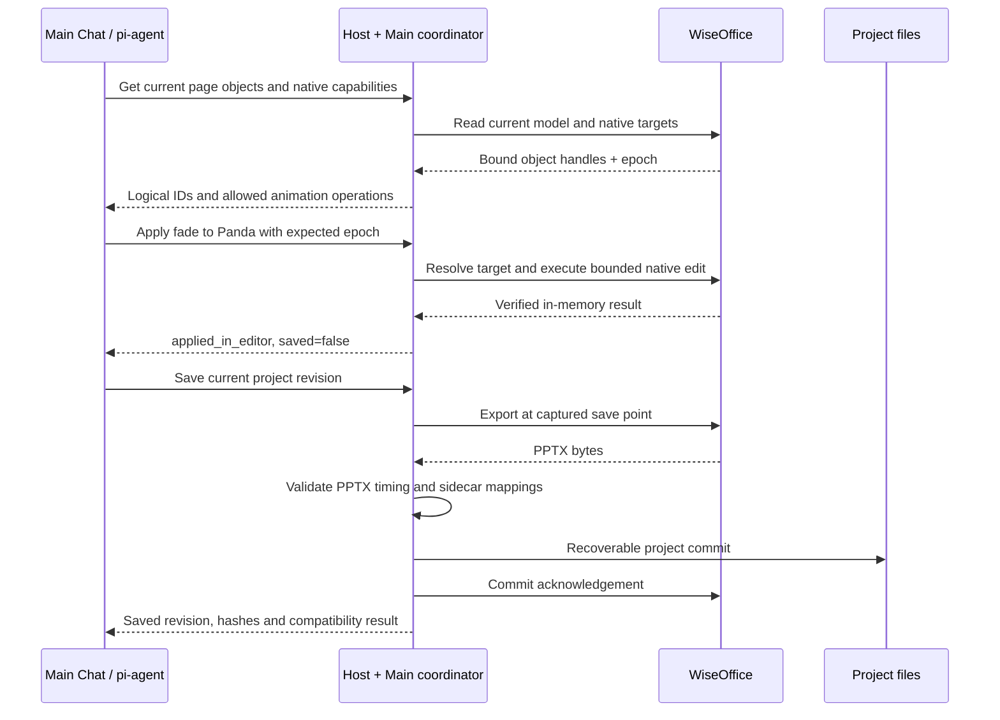

# WiseOffice teaching integration: implementation and acceptance plan

Date: 2026-10-28

Status: implementation in progress. The first native animation round trip and local-runtime source probes are implemented; see [progress and evidence](2026-10-28-wiseoffice-teaching-progress.md). Other gates remain open.

Design: [local editor, native animation, and teaching timeline](2026-10-28-wiseoffice-teaching-integration.md).

## 1. Delivery boundary

Deliver one local editor in DeckWise. Main Chat can target an object, apply a real
native animation, save it into PPTX, and report the actual persisted result.
The native right sidebar contains a page teaching timeline. Spotlight/highlight
are visible on the same slide, follow current geometry, survive project reopen,
and behave consistently in final playback.

Keep the current five-page real scene task intact as a later user-acceptance
fixture. Tests in this plan use isolated copies/profiles and local audio/video
fixtures. Paid generation is unnecessary for authoring correctness and must not
be triggered by loading, previewing, or rerunning tests.

Two repositories change: DeckWise (`D`) and WiseOffice/document (`W`). Cloud-web
is a UX reference. No Platform or llm-ha change is required merely to integrate
the editor; existing media relay orchestration remains in Desktop.

## 2. Source integration and documentation

Prepare dedicated implementation worktrees from current main, then integrate the
needed courseware and WiseOffice source changes through normal branch integration.
Do not build a release that implicitly relies on another worktree's dirty files.
Record exact Desktop/WiseOffice commits, SDK resource hashes, bridge version,
worker version, and sidecar schema in test evidence and packaging metadata.

The design analyzed D `feat/courseware-par-A` with existing uncommitted changes and
W `feat/wiseoffice-courseware-integration`; it is not a source patch against main.
The current documentation branch is `docs/wiseoffice-teaching-design-20261028`.

Before changing persistence, add a proposed architecture decision covering the
Host-owned project-file authority and migration; update the existing accepted
Host-owned courseware ADR only when the implemented behavior changes. Update native
Chat, fixed snapshots, authorized media, workflow, UX and E2E specs at each stage.
No broad workflow-document cleanup is part of this task; existing contradictory
local-main merge instructions defer to root AGENTS.md.

## 3. G0 — prove native SDK and geometry capabilities first

This gate is intentionally prior to a large UI migration.

### 3.1 Native animation write and round-trip probe

Use a local PPTX with two distinct images, a native text box, an existing supported
animation, notes, and an unrelated second page. Drive the real existing Chat-tool
dispatch with a deterministic tool invocation; a paid LLM is not necessary.

1. Bind editor and enumerate/select one exact target.
2. Invoke the existing appear/fade command and inspect native effect readback.
3. Save through the actual host acknowledgement flow.
4. Open the resulting ZIP and parse `ppt/slides/slideN.xml` plus relevant relationships.
5. Resolve timing targets to the intended shape; validate click condition, entrance
   type, effect, duration and sequence. Validate timing node references/IDs.
6. Confirm peer objects, previous animation, media, notes and other slides remain intact.
   Do not require byte-identical ZIPs or native IDs after a native export.
7. Close/reopen in WiseOffice and preview the animation with its native controls.
8. Undo/redo, save again, and inspect the output again.

Evidence: original/result hashes, semantic XML comparison, tool receipts,
save acknowledgement, screenshot/video of actual native preview, exact resource versions.
Mock SDK tests alone cannot pass G0.

### 3.2 Target addressing and preview control probe

Determine whether the current SDK can select/address one enumerated object without
depending on the user's prior click. Test stale IDs, object deletion, selection
changes, page changes, and restoring user focus. Inventory native animation list,
preview start/stop/completion, trigger/step selection and timing mutation calls.
Publish only verified capabilities; do not infer the whole SDK from one method.

For “play from here,” establish deterministic replay/reset behavior. If native
animation cannot seek directly, reset and replay supported preceding steps; label
the behavior accurately. Do not claim arbitrary millisecond seeking across native
animation and indefinite teacher waits.

### 3.3 Canvas overlay probe

Mount a temporary preview layer in the actual slide viewport and read SDK bounds.
Verify target geometry at 50/100/150% zoom, scrolling, sidebar open/close, window
resize, and supported display scale factors. Move/resize an image and perform
undo/redo. Verify the preview layer follows without saving/exporting the PPTX.
The probe must confirm clip bounds and CSS versus device pixels.

Probe native animation visibility/position while previewing. Entrance completion
followed by spotlight is the first mandatory composition. Motion-path tracking is
not assumed. Failure blocks only the unsupported combination and must be documented.

### 3.4 Native slideshow and complete lesson playback probe

Inspect the pinned SDK's demonstration methods and slide/end callbacks identified
in design section 10. Exercise them in a real slideshow, not only editor preview.
Distinguish native animation-step advance from slide advance. Establish reliable
step completion/visibility, play/pause semantics, full-screen surface ownership,
and embedded audio/video lifecycle before promising automatic combined playback.

Use local media to run: native entrance -> speech with spotlight -> song -> delay
-> video -> teacher wait -> next page. Repeat from a middle page; pause/resume in
each phase; navigate manually; exit by Escape; reopen preview. Verify one media
owner, no lingering audio, no duplicate animation and no stale callbacks. Place
overlays inside the actual full-screen surface, including supported presenter-window
configurations. Unsupported extra-window modes must be explicit.

### 3.5 Identity persistence probe

Test page reorder/copy/delete/undo and object copy/group/ungroup/delete/undo through
save/reopen. Test candidate custom metadata preservation in the actual exporter.
Choose the durable mapping strategy from evidence. A `WeakMap` or ordinal index
does not satisfy this gate. Duplicate shapes with equal content must not silently
inherit the wrong teaching target.

## 4. G1 — package and load WiseOffice locally

Change D `ppt-editor.ts`, `editor-host-protocol.ts`, `resources/editor-host/index.html`,
packaging/resource staging configuration; change W desktop entry/build paths as needed.

- Stage a pinned WiseOffice production artifact with a manifest of hashes.
- Register and serve its complete resource tree in the editor session.
- Validate path traversal, origin, MIME, precompressed WASM, workers, fonts and media.
- Preserve sandbox, context isolation, navigation limits and host message validation.
- Remove remote editor URL from the packaged normal opening path.
- Separate app installation resources from authorized project document/media reads.
- Open source bytes once; eliminate unconditional open-time archive/reread only
  after the source baseline remains available for conflict detection and snapshots.
- Reuse an initialized editor where its lifecycle supports safe document reset.

Acceptance: disconnect the network with a fresh profile, open/edit/save/reopen the
sample PPTX; no remote resource request, no initialization hang, no missing glyphs.
Test all supported OS packaging lanes. On representative hardware record cold and
warm timings for a five-page and a media-heavy deck, with at least five runs each;
report median and range. Set a release budget from measurements, not an invented
percentage speedup. Confirm no duplicated revision directory on unchanged open.

## 5. G2 — one project session and native right sidebar

Change W `lib/agent-plugin/ui/sidebar-entry.ts`, `panel-context.ts`, `lib/embed-api.ts`
and add scoped teaching UI/layout integration. Change D editor bridge/contracts,
teaching context orchestration and `PptEditorTab.tsx` / `CoursewareTeachingPanel.tsx`.

Keep one session binding: project/document/editor session, logical page, native
edit epoch, teaching revision, current selection, dirty state and capabilities.
Push page/selection/geometry/history events; apply an initial snapshot immediately
after content ready. Coalesce geometry updates; never coalesce away ordered edit
receipts. Define event sequence numbers and a full resync after a gap/reload.

Sidebar actions and Chat actions call the same validated operations. Native UI
events update the same model rather than requiring the user to reload teaching.
Preserve page-specific drafts during navigation. Do not put provider credentials,
filesystem paths or Host persistence code inside WiseOffice.

Acceptance: opening the editor automatically displays existing narration and audio;
switching pages or selecting an object updates the correct sidebar; native property
and teaching panes share one area; no outer second teaching panel remains active.
Keyboard focus, resize, collapse and text-entry shortcuts keep working.

## 6. G3 — native animation tools and verified save

Change D `packages/shared/src/ppt-editor-bridge.ts`, `packages/agent-runtime/src/ppt-editor-tools.ts`,
`runtime.ts`, Host tool/permission routing, `ppt-editor-chat.ts`, `ppt-editor.ts`;
change W `deckwise-editor-bridge.ts` and `slide-object-animation.ts`.

Implement the proposed tools only after G0 capability discovery. Reuse current
bounded commands instead of arbitrary SDK method forwarding or model-generated code.
Maintain current tool compatibility during rollout; remove redundant internal paths
after callers migrate, without silently widening plugin privileges.

Required sequence for “make Panda fade in and save”:



Document-wide automatic generation serializes native editor mutations against the
current epoch. Images/TTS may generate independently, but they adopt only against
matching content revisions. A user edit or navigation cannot redirect a pending
agent command to a new target. Visible unrelated documents are never commandeered.
If no authorized editor is ready, initialize a project-bound local session or return
an actionable state; do not silently fall back to shell/ZIP edits of the same file.

Acceptance: actual tool-to-PPTX round trip, selected and unselected target flows,
exactly-once receipts, cancellation, stale epoch, save failure, human edit conflict,
unsupported complex timing, and native undo. Any unknown outcome remains visible
and is not automatically re-applied.

## 7. G4 — teaching timeline, media and live cue previews

Add timeline operations to shared contracts and Host validation; implement the
sidebar in W; reuse Desktop local media preparation/adoption and archived assets.
Extend the existing courseware playback scheduler rather than adding a second
independent timeline engine.

- Render speech/audio/video/delay/teacher-wait nodes with reorder and keyboard controls.
- Speech nodes expose text, current voice, audio status, preview and regeneration.
- Audio/video nodes select existing local assets; media remains local during preview.
- Use explicit delay nodes; migrate legacy `pauseAfterMs` into equivalent order
  only when writing the new schema, preserving old playback behavior.
- Teacher wait is independent of the player's temporary Pause control.
- Selection can attach highlight/spotlight to a speech or explicit timed span.
- Reuse/extract pure geometry and cue selection from `FixedVisualEffects.tsx` and
  `spotlightGeometry.ts`; use an SDK geometry adapter for WiseOffice.
- Preview has one owned run ID, synchronized clocks, cleanup and cancellation.
- Surface actual errors; a failed audio/video node does not count as completed.

Acceptance includes edit/reorder/delete/undo/reopen, no-cost automatic reads,
TTS invalidation, audio/video buffering/error, pause/resume, delay freeze, teacher
wait, switch-page cancellation and late-event rejection. Deleting an anchor segment
must not silently retarget its cue; offer removal/rebinding within that edit.

## 8. G5 — sidecar persistence and migration

Change Host courseware repositories/RPC, shared teaching schemas, Desktop save
coordination and fixed snapshot assembly. Move portable content authority once;
do not put a filesystem writer into every renderer or tool.

The bounded sidecar schema needs:

| Field group | Required constraints |
| --- | --- |
| Header | Schema version, project UUID, committed revision, source hash |
| Page/object mapping | Unique logical IDs, native export evidence, no ambiguous alias |
| Timeline | Unique node IDs, validated node union, finite duration limits and ordered references |
| Native animation bindings | References to actual saved native effects/steps, no duplicate effect authority |
| Teaching cues | Valid targets, bounded style/timing, current audio hash for aligned cues |
| Media | Relative project paths, content hash, MIME and measured duration; reject escapes and remote signed URLs |

Implement project commit journal and per-project serialization before migrating
legacy records. Injection tests must stop after each write/rename/ack boundary,
restart, then observe the previous or next consistent version. Define file moves,
Save As, external edits and old-client behavior. Retain pre-migration content until
round-trip and restart tests pass; do not delete source projects or private receipts.

Acceptance: move the entire project directory, open it in a fresh isolated profile,
and recover teaching and media without the original machine's SQLite. Private
provider receipts are intentionally absent. A PPTX-only copy clearly lacks teaching.
Project portability is a storage requirement, not permission to add a copy command
to the editing toolbar. Per the user's 2026-10-29 correction, this toolbar exposes
neither an advanced-teaching toggle nor a complete-project-copy entry. Teaching
editing belongs exclusively to the native WiseOffice right sidebar.

## 9. G6 — final-player parity and removal of duplicate paths

Change `native-click-animations.ts`, fixed-build contracts, `fixed-build.ts`, player
loading/scheduling and cue target resolution. Keep native effects authoritative in
PPTX; sidecar trigger references must resolve against the saved native timeline.

Replace `before-narration`-only scheduling with validated teaching bindings for the
supported subset. Native click steps without bindings retain native/manual meaning.
Replace the blanket native-target/cue rejection only after tests prove an entrance
followed by cue is valid and no effect is executed twice. Mixed native with/after
sequences require scheduling support, not removal of validation.

Migrate or explicitly preserve legacy player-only animation cues. Remove the old
outer effects/voice UI after the native sidebar covers required workflows. Keep the
existing “inspection” diagnostic under an appropriate secondary command. Do not
remove validation, confirmations for actual conflicts, or source-loss protection
merely to simplify the page.

Acceptance: compare editor preview and exported playback for the same project:
objects, animation order, audio timing, cue target/style, teacher wait and completion.
Unsupported PPTX effects remain intact in the editable file and block an inaccurate
fixed export with a specific explanation. No successful export with silent loss.

## 10. Representative end-to-end acceptance matrix

| ID | User path | Required observable result |
| --- | --- | --- |
| E1 | Offline fresh launch -> open local deck -> edit -> save -> reopen | Entire editor initializes locally; edits persist |
| E2 | Main Chat asks for Panda fade without preselection | Correct object receives native effect; peer objects unchanged |
| E3 | Save E2 -> inspect OOXML -> close/reopen -> native preview | Real timing references correct shape; animation actually plays |
| E4 | Select Panda -> add spotlight to speech -> move/resize Panda | Preview follows immediately; no extra PPTX shape |
| E5 | Zoom/scroll/sidebar resize/display scaling during E4 | Overlay remains aligned and clipped to slide |
| E6 | Speech -> song -> delay -> video -> teacher wait -> speech | Actual completion drives sequence; wait needs teacher action |
| E7 | Pause/resume/stop during each media/delay/cue phase | All clocks and cues agree; no late event advances stopped run |
| E8 | Native entrance -> narration with spotlight on same target | No duplicate animation, conflict, or spotlight on hidden target |
| E9 | Copy/reorder/delete/undo pages and objects, save/reopen | Teaching retains correct logical targets or flags unresolved mapping |
| E10 | Edit text/voice -> regenerate only one segment | Other audio retained; obsolete timing invalidated |
| E11 | Crash at each project commit boundary -> restart | Consistent recoverable project, no mixed-version success |
| E12 | External PPTX edit -> open project | Proven matches restored; ambiguous links do not auto-bind |
| E13 | Move project directory -> fresh profile | Teaching and media remain available without old SQLite |
| E14 | Agent edit while user changes selection/page/session | Stale operation cannot affect a different target/document |
| E15 | Open a deck with unsupported advanced native effects | File remains editable; capability and export limits are explicit |
| E16 | Native animation and teaching edit -> undo/redo | Expected document and teaching state restored together where advertised |
| E17 | Preview lesson -> native slideshow with all teaching node types | Correct page/animation/media/cue order; teacher wait preserved |
| E18 | Fullscreen/resize/manual navigation/Escape during lesson preview | Correct slideshow-space overlay; all previous-page/run media cleaned up |
| E19 | Embedded video/music plus corresponding timeline reference | Exactly one playback owner; no duplicate audio/video |
| E20 | Native preview succeeds but fixed export has unsupported animation | Preview success does not hide publication incompatibility |

Each gate must preserve evidence from the actual integrated build. Test helpers
must not mock away native export, geometry, or media events in E1–E8. Unit tests
remain appropriate for schemas, cue selection, target reconciliation and journals.

## 11. Verification completed for this analysis

Executed against the inspected existing worktrees, not a new integrated build:

```bash
# W
pnpm exec vitest run test/unit/slide-object-animation.test.ts \
  test/unit/deckwise-page-lineage.test.ts test/unit/deckwise-editor-bridge.test.ts
# Result: 3 files, 90 tests passed.

# D/packages/agent-runtime
pnpm exec vitest run src/ppt-editor-tools.test.ts
# Result: 1 file, 65 tests passed.

# D/packages/courseware-runtime
pnpm exec vitest run src/conversion/lib/courseware/native-click-animations.test.ts
# Result: 1 file, 11 tests passed.
```

No new native browser/Electron round-trip test, network-off packaged launch,
production call, paid generation, or migration was performed. Historical successful
five-page playback verifies existing teaching assets, not the proposed native-editor
integration. G0 remains the first implementation task and an explicit release gate.

## 12. Completion definition

The work is complete when E1–E20 pass for the advertised effect/object subset on
the actual packaged integration candidate, existing projects migrate without loss,
and UI/agent/save/player agree about the same committed project. “Sidebar mounted,”
“SDK call returned,” or “PPTX saved” alone is insufficient.

Report any unsupported effect or platform explicitly. Preserve native content and
existing projects while expanding capability; do not call advanced animation
compatibility complete based on the appear/fade baseline.
