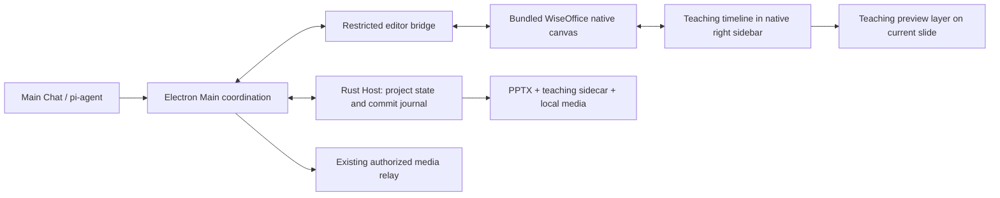

# Local WiseOffice and integrated teaching authoring

Date: 2026-10-28

Status: proposed design, supported by source inspection and targeted existing tests.
No runtime implementation, storage migration, packaged offline validation, or new
native animation round-trip validation was performed for this document.

Companion: [implementation and acceptance plan](2026-10-28-wiseoffice-teaching-implementation.md).

## 1. Decision and scope

The architecture is feasible, subject to the concrete SDK and identity gates in
the implementation plan. Bundle WiseOffice locally in DeckWise; put the teaching
timeline inside WiseOffice's own right sidebar; keep its native animation editor;
add teaching highlight/spotlight previews on the same live slide surface. Use a
local PPTX plus a versioned teaching sidecar and media directory for portable
project content, with one Host-owned writer.

Do not interpret feasibility as full existing support. In particular, arbitrary
PowerPoint animations, stable SDK identities after export, word-accurate audio
alignment, and mixed native-animation/teaching playback are not yet certified.

User requirements preserved:

- Scene mode serves kindergarten and primary education. The editor contract also
  serves plain generation and imported presentations.
- Existing main Chat and pi-agent are the only agent execution interface. A
  WiseOffice sidebar must not start another assistant or conversation.
- Keep teaching-plan approval and first visual-master style approval. Reading,
  saving, polling, and authorized generation must not introduce per-node approval.
- Keep provider-produced text image layers; do not reconstruct native text.
- Reuse WiseOffice's native animation UI and PPTX animation storage.
- A page timeline includes narration/TTS, audio, video, timed delay, and teacher wait.
- Selection, editing, preview, save, reopen, and final playback must agree.

## 2. Evidence baseline

Analysis inspected these existing worktrees without changing their implementation:

| Alias | Worktree / branch | HEAD |
| --- | --- | --- |
| D | `deckwise-desktop-worktrees/courseware-par-A`, `feat/courseware-par-A` | `578bbfeeb7ee61199ace12157ee78cd6656789e0` |
| W | `document-worktrees/wiseoffice-courseware-integration`, `feat/wiseoffice-courseware-integration` | `632c52012699ba20f27881991693b51021e6a50b` |
| C | `cloud-web-trainwise` | working-tree reference for timeline UX only |

D contains 127 pre-existing modified/untracked entries. Conclusions describe the
inspected working tree, not a claim that all features are present in that commit
or on main. W has an untracked generated online-entry directory, not used here.
This proposal lives on a separate documentation branch based on origin/main
`58a9c4f57`; implementation must integrate the required source branches first.

| Current behavior | Source evidence | Consequence |
| --- | --- | --- |
| Local PPTX bytes are read, archived into a revision, reread, and sent as `document:open-buffer`; default editor resource URL is remote | D `apps/desktop/electron/main/ppt-editor.ts`, `PptEditorController.open` | Remote resources and local file duplication are separate optimization targets |
| Editor resource view is sandboxed, uses an isolated persistent partition | D `ppt-editor.ts`, `createView`; `editor-host-protocol.ts` | Local packaging must preserve isolation and register resources on the correct session |
| Main Chat exposes a bounded native animation tool | D `packages/agent-runtime/src/ppt-editor-tools.ts` | A real agent-to-editor path already exists |
| Animation implementation calls `asc_AddAnimation` and verifies native state | W `lib/agent-plugin/slide-object-animation.ts` | This edits the native presentation model, not a player-only JSON effect |
| Current tool supports only selected ordinary objects, `appear`/`fade`, click entrances | same | Not sufficient for autonomous object selection, arbitrary effects, editing timing, or batch lessons |
| Current tool response is wrapped with `saved:false` | D `ppt-editor-tools.ts` | Model readback does not prove durable PPTX output |
| Save exports through WiseOffice and waits for Host commit acknowledgement | W `lib/embed-api.ts`; D `ppt-editor.ts` | Extend this flow rather than introducing an independent file writer |
| Existing injected sidebar button reaches the native right rail | W `lib/agent-plugin/ui/sidebar-entry.ts` | Entry mounting is reusable; shared panel layout still needs implementation |
| SDK selection/page/document/undo callbacks are already subscribed | W `lib/agent-plugin/ui/panel-context.ts` | Replace manual teaching reads and page polling with event-driven context |
| Page lineage uses a session-local `WeakMap` | W `lib/deckwise-page-lineage.ts` | Tokens cannot serve as durable page/object IDs across reopen |
| Player already draws spotlight/highlight overlays | D `packages/courseware-runtime/src/player/components/courseware/FixedVisualEffects.tsx` | Reuse effect semantics and pure geometry, not the entire player as a second editor |
| Fixed build projects a finite native click animation subset | D `.../conversion/lib/courseware/native-click-animations.ts` | Existing playback is not universally animation-blind |
| Fixed build rejects shared native-animation/teaching-cue targets | D `.../conversion/lib/courseware/fixed-build.ts`, `NATIVE_ANIMATION_CUE_CONFLICT` | Appearance followed by spotlight requires a deliberate scheduling change |
| Narration/audio/effect actions are presented together in cloud-web | C `components/canvas/editor-panels/narration-panel.tsx`, `action-timeline.tsx` | Reuse interaction organization without copying cloud storage ownership |

Baseline tests executed on 2026-10-28: W animation/bridge/page-lineage tests
90 passed; D agent editor tools 65 passed; D native click projection 11 passed.
They include mocks and finite fixture models. They prove tested contracts, not
the ability of a particular deployed SDK to export, reopen, or preview every effect.

## 3. Local editor architecture



WiseOffice renders and edits. Rust Host persists and arbitrates. Electron Main
coordinates finite operations. pi-agent decides requested edits through bounded
tools. Model generation, billing credentials, and filesystem access do not move
into the editor renderer.

Bundle a pinned WiseOffice production build, including its SDK, WASM, fonts, and
worker resources. Serve it through a dedicated secure application origin with
validated paths, MIME types, required encoding/isolation headers, and session
registration. The existing host protocol currently serves only host HTML; it does
not already serve an entire editor distribution. No `webSecurity:false` or Node
access in the iframe. Do not serve an arbitrary workspace directory as web root.

The concrete custom-protocol compatibility gate must cover same-origin nested
iframes, Blob URLs, Workers, WASM, streaming media, and all resource URLs. If the
pinned SDK demonstrably needs HTTP service-worker behavior that cannot be removed
from the desktop build, a restricted loopback static server is an evaluated
fallback, not a second simultaneously active loading path.

Skip web landing-page redirects and install/offline-download UI in desktop mode.
Do not depend on the web service-worker cache as the installed resource authority.
Resource and bridge versions must be pinned together. Optional heavy editor
resources may load lazily from disk; they must not fall back to remote assets.

Open the authorized source once, validate it, and send the same content to the
editor. Remove the mandatory open-time revision-copy/reread when project storage
can retain the required baseline safely. Keep immutable bytes for an actual
snapshot/export, conflict recovery, or a committed version. Atomic replacement
and backup retention are not unnecessary loading copies.

Measure before claiming improvement: source read/hash, resource load, SDK ready,
WASM init, PPTX conversion, fonts/images ready, first editable frame; compare cold
and warm opens on the same files. Existing same-file ready-view reuse should be
preserved. Cross-process buffers and internal editor conversion still exist.

## 4. How pi-agent writes native animation into PPTX

### 4.1 Existing complete dispatch path, incomplete persistence path

1. `runtime.ts` registers authorized PPT tools for an agent turn bound to the editor.
2. `ppt_get_context` obtains current ownership, page, selection, generation, and capabilities.
3. `ppt_add_slide_object_animation({effect, editGeneration})` sends a finite command.
4. Host permission dispatch routes through `runtime/host.ts` and `PptEditorChatBridge`.
5. Main verifies Chat/workspace/editor ownership, cancellation, generation, and capability.
6. `PptEditorController.execute` sends the correlated message through the preload/host page.
7. W `DeckWiseEditorBridge` calls `addSlideObjectAnimation`.
8. That function invokes `asc_AddAnimation(1, 1|10, 0, null, false, false)` and verifies
   target, added effect, previous effects, page, geometry, and peer objects.
9. The presentation is modified in memory. The current receipt means verified
   native edit, **not a saved PPTX**.
10. Existing Save sends `document:save`; WiseOffice exports bytes; Main persists
    them and sends `document:commit-save`. This is the point where native
    animation can become durable presentation content.

The model does not generate JavaScript or XML. It requests an animation against
a validated object; the native SDK writes its presentation model; its exporter
serializes the PPTX. The Open XML format stores timing under `p:timing` and resolves
shape animation targets through `p:spTgt/@spid` to the slide's shape identifiers.
SDK runtime `shape.Id` is not assumed equal to exported `cNvPr/@id`.

The official format references support this representation, not the fidelity of
our WiseOffice build. Save-and-reopen tests must inspect and resolve the exported
timing tree, rather than merely searching for the string `p:timing`.

### 4.2 Required extensions for an autonomous agent

The current selected-object tool is insufficient for “make the panda appear on
page 3” when no object is selected. Add one trusted target-resolution path:

- Enumerate logical pages and objects with semantic labels, thumbnail/geometry,
  eligibility, current native animations, and capability limits.
- Host resolves a logical object ID into a current editor-session handle.
  The model cannot supply a filesystem path or invent an SDK ID.
- A native operation resolves that handle again immediately before dispatch,
  binds the document/page/object/edit epoch, and serializes with human edits.
- Prefer direct native object addressing if the pinned SDK supports it. Otherwise
  select the exact validated target in a scoped operation; restore selection only
  if no intervening user navigation occurred. Never assume current selection survived.
- Expose supported preset, duration, trigger, and delay capabilities from the
  inspected native adapter. First implement the verified appear/fade subset;
  unsupported requests return an explicit capability result, not a silent substitute.
- Animation editing/reordering/deletion must affect native animation records.
  The sidecar stores references and teaching bindings, not duplicate effect definitions.

Proposed tool surface (names are design proposals, not existing endpoints):

| Tool | Purpose |
| --- | --- |
| `ppt_get_context` (extend) | Fresh page/object/animation inventory and supported operations |
| `ppt_apply_native_animation` | Apply a bounded native operation to a resolved logical target |
| `courseware_timeline_edit` | Insert/update/move/remove finite teaching nodes and cue bindings |
| `courseware_preview` | Preview a current page/segment without saving or publishing |
| `courseware_project_save` | Commit current PPTX and teaching revision and return verified status |

All tools use the existing main Chat permission mechanism. A user-authorized task
does not require a separate approval for each generated animation or cue. Existing
source or edit conflicts are resolved explicitly rather than overwritten.

Example proposed animation request:

```json
{
  "operationId": "op-uuid",
  "expectedEditGeneration": 42,
  "pageId": "page-uuid",
  "objectId": "panda-uuid",
  "operation": "add",
  "effect": "fade",
  "trigger": "click",
  "durationMs": 500
}
```

Host provides binding/session metadata. Capabilities validate every value. Current
code only accepts `effect` plus generation and a selected object; the above is an
extension, not a runnable example of today's tool.

Return separate states: `applied_in_editor`, `saved`, `roundtrip_verified`, and
`playback_compatible`. Save success does not imply every animation is supported
by the final player. A compound request finishes with the save receipt when saving
is part of its authorized scope. File replacement is never performed underneath
an open dirty editor by a parallel agent or ZIP patcher.

Operation IDs prevent duplicate dispatch. Before dispatch persist an intent;
after dispatch record readback and resulting document epoch. Lost response after
dispatch is `outcome_unknown`; inspect the current model/saved revision rather
than replaying. No disk mutation can be claimed atomic with a renderer mutation.
Known compound operations may use SDK history groups only after their behavior
is verified; otherwise report exactly which edits were applied.

### 4.3 Initial scene generation versus later Chat edits

Initial generation first compiles the chosen visual layers into editable PPTX
and establishes logical object mappings. It can then open a project-bound local
WiseOffice session, apply the planned native animations to those resolved objects,
and commit the result before declaring the lesson ready. The workflow does not
require a human to visit/select each page. It uses the same native mutation/save
operations as later Chat edits, with progress and cancellation owned by Desktop.
If a different document is being edited, it must obtain an isolated project session
or wait for the owning session; it must not commandeer the current canvas.

The LLM may plan animation intent before PPTX exists, but that intent is not a
native animation until applied and saved. Existing generated player-only
`element_animation` cues cannot simply be relabelled as PPTX animations. Convert
verified equivalents through the native path and retain the migration limits in
section 8. A future direct PPTX compiler can share the same bounded native contract
only after its exported results pass the same semantic and reopen tests.

## 5. Spotlight and highlight on the WiseOffice canvas

### 5.1 Two meanings of “in PPTX”

| Requirement | Representation |
| --- | --- |
| Native animation must survive opening the PPTX in an Office application | Native PPTX timing written by WiseOffice |
| Spotlight/highlight must be visible while editing/previewing the PPTX in DeckWise | Teaching preview overlay on WiseOffice's live slide surface |
| Spotlight/highlight must survive closing/reopening the DeckWise project | Versioned sidecar cue and durable target binding |
| Spotlight/highlight must play in bare PowerPoint with only the PPTX file | Not provided by the overlay/sidecar design |

A bare PPTX opened outside DeckWise does not execute our sidecar. Encoding teaching
spotlight as inserted dark shapes and transparency animations would be a different
export feature with layout/history/timing tradeoffs. It is not needed for the
requested integrated editor and must not be silently substituted.

### 5.2 Live geometry and rendering

Create a teaching overlay owned by the native slide viewport, inside the same
editor iframe as the canvas, clipped to the slide's visible area. Do not overlay
the entire Electron window or the thumbnails/sidebar. WiseOffice draws slide
content into canvases; a separate DOM element per PowerPoint object is not assumed.

Resolve logical target -> current native object -> current slide-space geometry.
Use the SDK drawing transform where available. Express the calculation as
`viewportPoint = slideToViewport * groupTransforms * objectPoint`, accounting for
rotation, zoom, scroll, slide origin, and iframe offset. CSS-pixel geometry and
device-pixel canvas backing scale must not be mixed. `ConvertCoordsToCursorWR`
appears in the bundled SDK; its precise slide/iframe coordinate semantics still
require a runtime probe.

- Highlight: SVG outline/fill/glow using resolved object bounds or polygon.
- Spotlight: dim the slide and subtract the union of target regions. Overlapping
  holes must not cancel each other under even-odd filling.
- Read-only preview overlays use `pointer-events:none`. Region-drawing tools
  capture input only during an explicit edit gesture; Escape cancels that gesture.
- Sidebar resize, window resize, slide change, object transform, undo/redo, and
  zoom/scroll refresh geometry. Throttle redraw to animation frames and dispose
  all subscriptions with the document session.
- Preview is transient: it must not set PPTX dirty, insert shapes, change z-order,
  or contaminate exported slide images. Only saving the cue changes teaching data.
- The first supported target set is ordinary whole slide objects. Crops/groups,
  rotated geometry, and region targets are enabled only with passing geometry tests;
  unavailable cases are stated, never guessed using screenshot coordinates.

Extract the existing player's pure cue selection and overlay geometry into a
browser-safe module. WiseOffice supplies native geometry; the fixed player supplies
imported geometry. Both use the same style defaults, overlap policy, and timing.
Avoid importing the whole React player into the WiseOffice iframe.

### 5.3 Previewing native motion alongside cues

Call the existing WiseOffice animation preview/demonstration machinery for native
effects. Do not fake native animation with a second CSS animation on a slide image.
The exact controller for play/pause/stop/completion and animation-step addressing
must be verified for the pinned SDK. Presence of `asc_StartAnimationPreview` in
vendor code alone is not sufficient proof of the desired behavior.

After an entrance completes, a static object's spotlight is straightforward.
Tracking an object during motion needs actual animated transform/visibility
readback. Until supported, schedule teaching cues after that motion or report the
overlap as unsupported. Do not display a spotlight over the object's stale position.

## 6. One right sidebar and a page teaching timeline

Native background/image/text properties and teaching content share the native
sidebar content area. Teaching mode has a timeline plus contextual node settings.
It must not leave the current Desktop teaching panel mounted as a competing owner.
Reuse the existing right-rail entry and SDK lifecycle hooks; implement a bounded
panel-layout adapter for the pinned vendor build instead of scattered DOM patches.

Timeline node semantics:

| Node | Completion and controls |
| --- | --- |
| `speech` | Edit text and voice; preview existing TTS; wait for audio `ended`; changed text/voice invalidates only the linked audio/alignment |
| `audio` | Local asset, optional clip bounds; wait for actual playback completion by default |
| `video` | Local asset plus page video target/defined display region; wait for actual completion by default |
| `delay` | Explicit milliseconds, counted only while playback runs |
| `teacher_wait` | Indefinite until teacher continues; shows an optional instruction |
| `native_animation_ref` | Reference an existing native animation/step, for explicit teaching scheduling |

The last node is a trigger reference, not an additional animation editor. Existing
PPT click/with/after sequencing must remain native unless the user explicitly binds
the step to the teaching timeline. Never let native auto sequencing and a teaching
trigger both execute the same effect.

Support drag/keyboard reorder, insert/delete, collapsed summary, current-playing
node, segment preview, and page preview. Opening a page reads saved data and draft
automatically; it never starts paid generation. Keep drafts per logical page so
navigation need not discard or silently freeze unsaved work.

The playback state machine is `idle -> playing -> waiting_teacher | paused |
completed | failed`. User Pause freezes all participating media, delay time, and
cues; Resume preserves progress; Stop cancels and resets transient overlays.
Late media events are ignored after a run/page generation changes. Teacher Continue
only advances a teacher wait; it does not bypass a failed or still-playing clip.

Use actual audio/video playback time as media clock, not a wall-clock timeout equal
to estimated duration. Metadata loading and buffering do not advance narration.
Indefinite waits and unknown audio lengths have no fabricated absolute timeline time.
Word anchors are displayed as accurately timed only when alignment is available
and tied to the exact audio/text hash; otherwise use segment start/end or explicit
offsets with visible limitations. Regenerating TTS invalidates stale timing.

## 7. Durable identities and a portable project

Proposed layout:

```text
Unit1/
  Unit1.pptx
  Unit1.teaching.json
  assets/
    narration/<content-hash>.mp3
    music/<content-hash>.mp3
    video/<content-hash>.mp4
  .deckwise/                 # commit recovery metadata; not UI content
```

One Rust Host writer owns project serialization. The sidecar becomes authoritative
for portable committed teaching content only after migration. SQLite retains
private generation receipts, account partitions, jobs, recovery journals, and
rebuildable project indexes. Do not dual-write two authoritative teaching copies.
Drafts can remain Host-owned private data, explicitly distinguished from commits.

The sidecar contains schema version, project UUID, commit ID, source hash/revision,
logical page/object/animation mappings, ordered nodes, cue bindings, and relative
media references with hashes. It contains no access tokens, signed URLs, or billing
credentials. Proposed examples must be converted to strict bounded shared/Rust
validators before use, preserving existing teaching policies and locks.

Use two identity layers:

1. Transient editor handles are bound to a document session and edit epoch.
2. Durable logical UUIDs identify project pages, objects, and native animation refs.

Persist logical IDs through a supported PPTX extension/custom metadata mechanism
only after proving preservation through the exact SDK exporter. Existing session
WeakMap tokens do not provide this. If preservation is unavailable, save-time
reconciliation uses exported part/shape identity plus content/geometry evidence;
ambiguous matches become unresolved. Duplicate pages/objects get new logical IDs,
with copied teaching only under defined copy behavior. External edits require
reconciliation; page order alone never decides a cue target. Delete/undo must remove
and restore associations with the corresponding object history operation.

## 8. Save, undo, migration, and compatibility

Expose one Save/Ctrl+S for the project. Retain individual PPTX and teaching dirty
state internally, but show one coherent saving/saved/conflict status. Sidecar-only
edits do not require re-exporting unchanged PPTX.

PPTX and JSON cannot be atomically replaced together by two ordinary renames:

1. Pin expected source/teaching versions and an editor save point.
2. Export if PPTX changed; validate package, target identities, and teaching schema.
3. Write/sync temporary files on the same volume; retain previous committed bytes.
4. Persist a prepared journal with hashes, paths, and commit ID.
5. Replace required files and record the committed journal state.
6. Acknowledge the editor only after durable commit; preserve edits made after the
   captured save point as dirty.

On restart, inspect hashes and journal to complete or roll back an interrupted
commit. Until resolved, do not open mismatched PPTX/teaching as a valid project.
External source edits before replacement cause a conflict, not overwrite. Document
what fsync/replace guarantees exist on each supported platform. Power loss between
separate writes remains a recoverable transaction, not a claim of OS atomicity.

Undo/redo must correlate native history and teaching history with operation IDs.
Standalone timeline edits use teaching history; compound edits coordinate both.
If the pinned SDK cannot reliably group them, do not advertise a single atomic
compound undo; the capability gate must be resolved before releasing that interaction.

Migration is opt-in at project open/save during rollout, idempotent, and non-destructive:
read legacy Host teaching, validate against PPTX, copy/link verified media into the
project where safe, commit sidecar, then mark authority migrated. Retain the legacy
record for recovery, not active writes. Existing player-only `element_animation`
cues must be inventoried: convert verified native equivalents with proper bindings;
preserve unsupported effects in legacy playback until resolved. Never silently drop
or reinterpret pulse/emphasis as an entrance.

Old app versions must not write the new project schema. Unknown versions open
read-only with a clear explanation. Normal PowerPoint can still edit the PPTX;
teaching enhancements require the accompanying project and DeckWise runtime.

## 9. Final playback compatibility

The current finite projection supports whole-object click `appear`/`fade`, duration
1–5000 ms, and `sequence:"before-narration"`. It rejects complex timing, text-range
targets, group targets, and unsupported presets. Current build also rejects cues
targeting native-animated objects. These are explicit implementation restrictions.

Extend the existing parser/projection/player path; do not add another animation
authoring source. Introduce a versioned capability matrix shared by authoring and
export: native-save capability, native preview capability, and fixed-player
capability are different. Saving unsupported-player animation is allowed without
destruction; final package generation reports actionable incompatibility rather
than silently omitting the animation.

For the required basic path, a native entrance followed by spotlight/highlight on
the same object must pass. Replace the blanket conflict rule with a proven visibility
and scheduling rule. Native transforms run once; teaching overlays use the current
visible geometry. Tests must compare native preview and final-player order, timing,
target and pause/resume behavior. Arbitrary motion-path fidelity remains a separate
capability expansion, not a prerequisite to documenting this bounded architecture.

## 10. Tradeoffs and explicit exclusions

### Integrated slideshow and complete lesson preview

Additional user requirement: launching slideshow should be capable of playing
TTS, music, video, teaching cues and native animations together. A dedicated lesson
preview entry is acceptable. Prefer an explicit **Preview lesson** entry in the
WiseOffice toolbar/right sidebar, offering current page or whole lesson. Retain
the existing **Slide show** entry for native presentation playback until combined
playback has passed its acceptance gates. Explain the distinction in tooltips;
do not imply the existing slideshow automatically consumes teaching sidecars.

For the enhanced preview, prefer the WiseOffice native slideshow canvas plus the
existing teaching scheduler. This is another launch mode, not a second animation
editor or a second independent teaching timeline. It preserves the native rendering
path while giving DeckWise control over teaching sequencing.

Source inspection of W `public/sdkjs/slide/sdk-all-min.js` found native
`StartDemonstration`, `DemonstrationPlay`, `DemonstrationPause`,
`DemonstrationGoToSlide`, `DemonstrationNextSlide`, `EndDemonstration`,
`asc_onDemonstrationSlideChanged`, and `asc_onEndDemonstration` implementation
symbols. This supports the feasibility of a slideshow adapter, but does not prove
precise animation-step completion, synchronized media clocks or full-screen overlay
placement. Native Play/Pause does not automatically control sidecar media.
The inspected `StartDemonstration` also calls the plugin manager's `stopWorked`
when present. Keep the teaching coordinator owned by the host/editor session,
not by an assumed persistent ordinary plugin panel; verify that bridge events
and playback adapters remain active when native slideshow starts.

The teaching scheduler owns the run and coordinates a bounded native slideshow
adapter with audio/video and overlay adapters. It must:

- Capture a consistent PPTX/teaching revision before preview. If the preview uses
  saved state, save through the normal project commit and then start; do not quietly
  preview an older version or discard current drafts.
- Start the correct page, resolve that page's logical targets into slideshow-space
  geometry, and mount cues inside the actual slideshow/fullscreen surface.
  Editor-space geometry cannot be reused without a new transform.
- Let native animations execute through WiseOffice. Read verified native step
  and completion state; do not simulate clicks with guessed timeouts. “Next” may
  advance an animation step or a slide, so slide changes alone are insufficient.
- Assign exactly one execution owner per media item. Embedded native media can be
  delegated when control/completion are verified; sidecar media uses the teaching
  media adapter. Never start the same music/video through both paths.
- Play sequential timeline audio/video until their actual completion, then delay
  or continue as specified. Background music overlapping speech requires an explicit
  accompaniment role with scope/volume and end policy; an ordinary audio node
  remains sequential by default.
- Freeze native animation, media and cue clocks on Pause. Stop/escape/close must
  clean all clocks, overlays and listeners. Browser autoplay/fullscreen rejection
  must offer a user Start action, not silently advance.
- Cancel old page media on manual navigation and reset the destination page run;
  a late `ended` event from the previous page cannot advance the new page.
- Auto-advance only after required nodes/native steps complete. Teacher waits and
  explicitly manual native clicks remain interactive unless deliberately bound to
  the automatic timeline. A wait never finishes by a hidden timeout.

Validate whole-lesson preview and same-page preview through the same scheduler.
Publication still needs the separate fixed-player compatibility gate in section 9:
successful native preview is not evidence of fixed-player fidelity. If the pinned
SDK cannot expose reliable native-step control, do not ship combined native preview
with approximate synchronization. Use the existing fixed preview only for its
declared supported subset, with explicit compatibility diagnostics, while retaining
native slideshow for the PPTX itself.

### Other alternatives

- Moving existing forms into an outer iframe wrapper is cheaper but leaves the
  same split editor and geometry problem; it does not meet the request.
- Putting highlight/spotlight into native PPTX shapes pollutes content and history;
  reserve it for a separately specified standalone-PowerPoint export requirement.
- Direct XML patching while WiseOffice owns a dirty document creates competing
  sources; use native SDK edits and its save path. Offline generators may only
  emit a new closed document under the project ownership protocol.
- Bundling hundreds of MB of local SDK/font resources increases installation size;
  measure the actual release distribution. It removes network startup dependence,
  not WASM initialization or PPTX conversion cost.
- Building a second animation panel, an agent inside WiseOffice, or a new cloud
  task controller is outside this design.

## 11. External format/platform references

Checked 2026-10-28; current bundled code remains the authority for supported calls.

- [Open XML Timing (`p:timing`)](https://learn.microsoft.com/en-us/dotnet/api/documentformat.openxml.presentation.timing?view=openxml-3.0.1).
- [Open XML ShapeTarget (`p:spTgt`, `spid`)](https://learn.microsoft.com/en-us/dotnet/api/documentformat.openxml.presentation.shapetarget?view=openxml-3.0.1).
- [Electron protocol handling and privileged schemes](https://www.electronjs.org/docs/latest/api/protocol).

These references establish format/protocol capabilities. They do not certify
WiseOffice round-trip support, local-scheme compatibility, or final-player fidelity.
