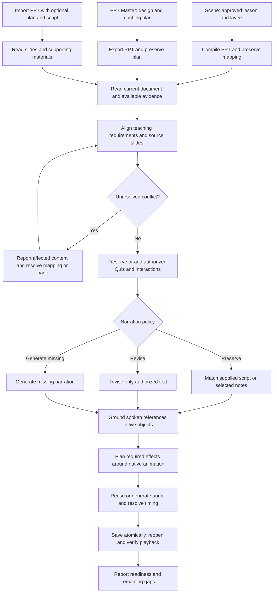

# Shared teaching enrichment for three courseware entries

Status: implemented in the Part A candidate. See the [implementation evidence](2026-11-10-shared-teaching-evidence.md) for exact local qualification and external limits.
Date: 2026-11-10. Workspace: `feat/courseware-par-A`.

Read this document for intended behavior, the [implementation approach](2026-11-10-shared-teaching-implementation.md) for code ownership and migration, and the repository execution plan `plans/008-shared-teaching-enrichment.md` for ordered tasks and acceptance gates. The plan lives outside the documentation site.

## 1. Product outcome

Keep three ways to obtain a presentation. Afterward, use shared teaching capabilities to complete the requested lesson, preserving work that is already usable.

- **Scene:** design the lesson and visual layers together, then compile the PPT.
- **PPT Master:** design and export the PPT, retaining the teaching plan and generation evidence.
- **Import:** use an existing PPT, optionally accompanied by a lesson plan and/or narration script.

For example, a teacher imports a PPT, a lesson plan and a finished script. The system maps the plan's activities and the script's paragraphs to the original slides, adds authorized missing assessments, and binds speech to actual slide objects. It creates or reuses audio and synchronizes effects. It does not need to write a replacement script.

Scene mode is the capability benchmark. Its current generation path remains intact. Sharing enrichment must not discard its approved activity arrangement, visual assets or object mapping.

## 2. Scope and boundaries

In scope: local native PPT teaching; optional supporting materials; plan/page and script/page alignment; Quiz and interaction completion; narration policies; object grounding; native animations and speech-linked effects; media reuse; durable save, restart and completion checks.

The existing cloud import path remains server-owned. Its behavior is a reference, not a new dependency of local authoring. This proposal does not move server classrooms into native documents, migrate all historical projects, replace the scene visual generator, redesign the player, or add a generic workflow engine.

The original planning-only delivery has been followed by implementation in the linked plan. Existing media authorization, document locks, task ownership and save rules continue to apply.

## 3. Baseline and evidence

This table records the historical design investigation. The implementation used newer workspace files; exact implementation commits, fingerprints and resources are recorded in the evidence report. Commit IDs alone do not reproduce an uncommitted candidate.

| Checkout | HEAD inspected | Role |
| --- | --- | --- |
| Desktop Part A | `c2173081eda9cea4a5baef47b2f4bdfeeb76a541` | Implementation target; dirty working tree |
| document Part A playback | `724ae08b1a1f1466cfa32c3fe67b1354cc2cb308` | Native editor integration; dirty working tree |
| evo-trainwise-maic-server | `bd335c7e0369e06e416ac83bb7a47bec86b36bc0` | Read-only comparison; clean when inspected |

Observed behavior:

| Area | Current evidence | Consequence |
| --- | --- | --- |
| Scene generation | Structured teaching plan, visual master, decomposed foregrounds, compiled mapping, separate assessment slides | Reuse this information instead of reconstructing it from screenshots |
| PPT Master | Adoption carries page teaching and Quiz data; common publication embeds generation metadata | Validate the first semantic association between planned pages and exported slides |
| Native narration | Live object evidence feeds shared visual grounding and deck planning | Extend existing interfaces, not a second narration implementation |
| Local import | File import preserves PPTX; native activation can seed speech from notes | Notes existence alone does not establish the user's desired script policy |
| Cloud import | Desktop auth flow already uploads PPT and lesson-plan files to the platform | A cloud attachment feature is not proof that native local import supports it |
| MAIC import | Separate lesson-plan and narration-script inputs; blueprint mapping; script alignment; assessment insertion; animation synchronization | Port useful rules with local ownership and actual source identities |

See the [native generation record](2026-11-10-native-generation-loop.md), [parity audit](2026-11-10-native-teaching-parity-audit.md), and [native document authority ADR](../adr/native-teaching-document-authority.md).

The earlier Office recovery failure was superseded by newer evidence inspected during document preparation: `native-narration-recovery-20261110/narration-reread-office5.log` reports one passed real Office test, and `office-recovery-result.json` reports a successful reread/save. `workflow-gate.json` reports PASS and zero provider calls; its native-editor field is `not-run`, so the separate Office log is necessary. These files are under `/home/jhz/deckwise-validation/`. They were inspected, not rerun for this documentation task. The user's actual lesson still needs its page-8/page-9 plan/content mismatch resolved; recovery tests do not repair that lesson.

## 4. Required behavior

| ID | Requirement |
| --- | --- |
| R01 | Preserve all three entry paths and scene mode's existing capabilities |
| R02 | Accept a PPT alone, with a lesson plan, with a script, or with both |
| R03 | Separate teaching intent, actual slide evidence, approved script and inferred suggestions |
| R04 | Validate plan/page and script/page alignment; retain original page identity after insertion/reorder |
| R05 | Preserve accepted teaching/media and add only authorized missing content |
| R06 | Support script preservation, authorized revision and generation as distinct policies |
| R07 | Keep Quiz, teacher-led interaction and ordinary teaching pages distinct |
| R08 | Bind effects to real objects and account for existing native animation visibility |
| R09 | Recover safely from content edits, cancellation, restart and uncertain writes/submissions |
| R10 | Persist native teaching in the PPT; use immutable snapshots for export |
| R11 | Report completed, partial and blocked work truthfully, with actionable page-specific causes |
| R12 | Qualify behavior across the editor, saved PPT and fixed playback, not only model output |

## 5. End-to-end flow

This is a user-facing dependency flow, not a requirement to run every step. Imported scripts are anchored to original slides before structural insertions; their bindings survive the later assessment step. Whole-course context informs all body narration, including transitions into planned activities. The final course order is settled before new narration is finalized.

## 6. Three entry-specific preparations

### 6.1 Scene

Preserve approved page identities, teaching objectives, visual intent, visible-text expectations, provisional narration, Quiz/checkpoint definitions, selected assets and compiler mapping. Keep music/video requirements and their existing provider jobs.

Current body slides use decomposed image layers, including lettering. A known layer role is a useful semantic candidate, but it is not proof that the returned pixels depict the intended object. Check changed or unverified visual content. Reuse validated associations only while their object and content fingerprints still match.

Planning narration is a draft unless explicitly accepted as final speech. Existing accepted speech takes precedence over the draft. Do not regenerate accepted pages simply because the entry is scene mode.

### 6.2 PPT Master

Preserve the official export gate, source hash, teaching plan, notes, assessment definitions and available design-to-export associations. Inspect exported shapes, groups, text and actual pixels.

Validate both physical identity and semantic correspondence before accepting the page plan. Matching page counts or an array position is insufficient. If a planned question page contains vocabulary cards, return a content mismatch that points to both the requirement and the actual slide. Do not silently swap plans, weaken requirements, or repeatedly regenerate speech.

When evidence uniquely identifies a mapping error, propose the mapping correction through the existing review path. When the requirement is correct and artwork is wrong, repair the actual document through the authorized editing path. An SVG-only edit is not an edit to the open PPT.

### 6.3 Imported PPT and supporting materials

| Inputs | Preparation | Speech policy default |
| --- | --- | --- |
| PPT only | Read content/notes, obtain essential teaching settings, infer a reviewable teaching arrangement | Ask/select notes or generation when not already specified |
| PPT + plan | Extract stages, knowledge and activities; map them to source slides | Generate missing speech if authorized |
| PPT + finished script | Resolve page anchors and paragraphs; identify existing assessments | Preserve supplied speech |
| PPT + plan + finished script | Map teaching activities and speech independently; expose conflicts | Preserve supplied speech; plan directs authorized activities |

Files are assigned a role by user intent, not solely by extension or filename. A source labelled as a draft is not automatically a finished script. Support text/Markdown and the existing document extraction routes for Word/PDF where qualified. Unsupported, empty or image-only extraction is reported explicitly; it is never represented as a successfully understood plan. Phase P2 inventories exact parser availability before promising file formats.

A plan stage may span several slides; one slide may serve several teaching moves. Store unmatched stages/activities as visible gaps. Knowledge, examples and classroom props from the plan may legitimately go beyond the screen. Only claims about visible objects must be grounded in the actual slide.

## 7. Information and precedence

These are logical fields to fit into existing contracts; they do not define a second public teaching schema.

| Information | Meaning | Authority and update rule |
| --- | --- | --- |
| Teaching requirements | What learners should learn/do; audience; required activities/media | Explicit user choices and accepted plans; model inference remains identifiable |
| Page evidence | Current text, objects, pixels, notes, native timing | Current document, versioned by content rather than selection state |
| Script | Spoken paragraphs, their origin and selected treatment | Accepted manual/supplied wording; exact content preserved under preserve policy |
| Bindings | Requirement-to-page, paragraph-to-page, spoken-reference-to-object | Valid only for their identified source revision and targets |
| Existing outcomes | Questions, actions, audio, effects, confirmations | Current saved native document and verified media |
| Diagnostics | Missing coverage, ambiguity, unsupported capability, stale result | Explicit unresolved state; warnings never certify mandatory work |

Precedence is per concern. Explicit user revisions govern intent; live PPT governs screen facts; an accepted script governs words. When these disagree, preserve the inputs and expose the conflict. Do not pick one globally and rewrite the others.

Suggested binding record fields: stable source ID, source hash, original page ID/ordinal, current native page UUID, paragraph/activity ID, target object UUIDs, binding method (`explicit`, `compiled`, `inferred`, `confirmed`), and the relevant content fingerprint. Exact field names are finalized with existing schemas in P1.

Original PPT page numbers are source anchors, not current display positions. Inserted pages have their own IDs and an anchor to a source page/activity. Copying a page creates new identities; it does not silently duplicate the assignment of a script paragraph to two pages.

## 8. Narration rules

### Preserve

Keep all supplied spoken content and paragraph order. Remove only recognized authoring labels such as page headings and explicitly non-spoken metadata; retain the original extracted text and source locations for audit. Numeric facts, greetings and spoken video references survive cleanup.

Explicit page sections bind deterministically. Semantic matching is used only for unlabelled paragraphs, within neighbouring anchors. Every paragraph must map exactly once; unknown, duplicate, out-of-range or reversed mappings are actionable failures with at most one format/matching repair attempt.

An explicit page number establishes placement, not semantic correctness. If the script says a visible red apple exists and evidence contradicts that, report the conflict without silently rewriting the accepted words or relocating the paragraph.

A missing script page is not automatic permission to invent speech. Classify it as intentionally silent, a media/activity page, or unresolved coverage. User-selected generation may fill only the unresolved pages included in its scope. Newly inserted assessment prompts use their own question-reading actions; they do not alter the original script.

### Revise

Require an already expressed revision scope: selected pages/paragraphs and requested change. Keep unaffected text and adopted audio. Only changed speech loses its old audio/timing binding. Do not treat a style setting change as permission to rewrite a fixed script.

### Generate missing

Reuse the existing deck planner and structured narration generator. Supply the full ordered course summary, plan guidance and neighbouring activity context; generate only requested missing pages. Preserve notes as evidence, not proof of visible objects or completed narration.

Focus planning is separately callable for preserved and generated speech. A greeting or classroom instruction can have no visual target. A failed optional focus inference leaves usable speech intact and reports its limitation; an explicitly required focus effect remains unfinished.

## 9. Quiz and interaction rules

Use existing independent Quiz and checkpoint contracts. Each generated Quiz has one question on its own slide. Keep answers, feedback and reference guidance outside student-facing artwork and ordinary narration.

Plan activities by purpose: objective answers use Quiz; open discussion/practice/PBL use the existing interaction contract; a demonstration or rhetorical question can remain ordinary teaching. Do not convert every question mark into an assessment.

First inventory structural assessments and visible question-like content. A visible question without answer/configuration is a candidate, not a ready Quiz. Prefer preserving or explicitly converting it over inserting a duplicate. Unknown answers require resolution rather than guessed grading data.

Use stable activity/question IDs and insertion anchors for idempotency. Text similarity may suggest a duplicate but is not sufficient to merge activities. After insertion, update order and bridges while retaining source-page anchors. Existing scene/PPT Master assessment arrangements are reused.

Completion requires actual question content and bindings, not just the planned count. If the plan requires a discussion and only a Quiz exists, the requirement is still missing.

## 10. Objects, animation and media

Keep native object identity separate from labels and model descriptions. Resolve shape/group/image targets from the current document. An entire slide image cannot supply independent rabbit/apple object IDs; mark unsupported granularity and request a valid target or supported region capability rather than fabricating shapes. Region targeting is not added by this proposal.

Read native entrance/exit/click order before finalizing synchronized effects. Keep existing native timing and explicitly requested custom animation. Effects on objects not yet visible must be moved to a valid phase or reported as conflicts. One persisted effect has one playback owner; native timing and speech metadata must not replay the same effect twice.

Plan target/phrase relationships before audio. Resolve actual intervals from verified audio and the existing timing path. Keep music/video requirements and already adopted clips. Reuse original provider orders and matching audio; uncertain submission is recovered by query, never replaced by a new purchase.

No arbitrary animation preset or full PowerPoint fidelity is implied. Unsupported timing receives a capability diagnostic and cannot pass a required-animation gate.

## 11. Incremental work and recovery

Use existing finite continuation and provider journals. Compute pending work from the current document and the requested outcome; avoid a second mutable course database.

| Change | Required reaction |
| --- | --- |
| Selection/navigation only | Refresh editor state and retain valid model output |
| Target page text/image change | Re-read evidence; invalidate dependent semantics/narration/effects, preserving manual teaching |
| Object geometry change | Revalidate target geometry/timing; preserve words unless their content depends on the change |
| Script paragraph change | Recompute that paragraph's bindings/audio/effects only |
| Plan or course-order change | Revalidate affected activity mappings and transitions; preserve accepted unrelated speech |
| Peer-page content change | Recheck dependent course briefs; do not blindly reuse stale cross-page claims |
| Source page deletion/replacement | Mark dependent anchors unresolved; never redirect by ordinal |
| Lost write acknowledgement | Read current revision/actions before retrying |
| Switch document/session or read-only/lock | Stop late writes and paid submissions; report current ownership |

Bound rereads and retries using existing service budgets. Deterministic content mismatch remains blocked until relevant content/intent changes. Save successful independent pages; a partial batch is not a complete course.

Cache only validated results, keyed by their actual dependencies: page content/object fingerprint, relevant plan/script revision, model/prompt version and context dependencies. Selection counters are not semantic fingerprints. Never treat the whole-document teaching revision alone as proof that every page needs paid reanalysis.

## 12. Storage and compatibility

The native PPT remains the editable authority for teaching, adopted media and accepted bindings. Host owns private attachments, extracted source material, task receipts and authorization. Keep credentials, local paths and full private attachments out of public PPT metadata.

Persist the accepted plan/script content needed to continue teaching after reopening, together with provenance hashes and source anchors, using a bounded, versioned extension of the current carrier. Document history must undo related visible and teaching changes together. Extraction caches and transient runs may be discarded without losing accepted teaching.

Old native documents without enrichment metadata remain readable and playable. Missing provenance is `unknown`, not evidence that existing speech may be replaced. Add metadata lazily through an explicit editing operation. Legacy Host projects retain their existing route; no bulk migration is scheduled.

P1 must prove serialization, package bounds, old-reader behavior and the version/feature gate before adding fields. If older writers drop required metadata, block unsupported editing with a clear capability message; do not allow a lossy round trip. Record the extension decision in an ADR before implementation of the format change.

## 13. Completion and user experience

Reuse the current entry, teaching and media surfaces. Show materials, selected script treatment, planned additions and unresolved conflicts in plain language. Preserve existing settings; ask only for information that changes scope or correctness.

A task reports `complete`, `partial`, `blocked` or `cancelled`, with per-page outcomes and missing required capabilities. Optional warnings are separate. The completion predicate checks requested activity coverage, script coverage or intentional silence, valid bindings, required audio/effects, and successful durable save.

Examples: "Slide 8 contains vocabulary cards; its plan expects two questions"; "Script paragraph 12 has no matching source slide"; "Speech is saved; the required spotlight still needs a target". Developer hashes and model transport details stay in diagnostics, not primary UI.

## 14. Acceptance scenarios

| ID | Scenario | Required observable result |
| --- | --- | --- |
| A01 | Existing complete scene lesson | Same pages, assessments, accepted speech/media and playback; no duplicate generation |
| A02 | Correct PPT Master export | Teaching requirements bind to actual pages/objects; missing teaching completes |
| A03 | PPT Master page-8/page-9 mismatch | Specific mismatch before paid narration/TTS; unchanged retry does not repeat generation |
| A04 | PPT alone | Selected notes/generation policy respected; actual page facts constrain visual claims |
| A05 | PPT + lesson plan | Stages and activities mapped, unmatched items visible, no duplicate assessments |
| A06 | PPT + numbered final script | Spoken content preserved; original page anchors survive inserted activities |
| A07 | PPT + unnumbered/mixed script | Every paragraph mapped once within bounds; ambiguity reported without invented speech |
| A08 | PPT + plan + script | Plan guides activities, script governs words; conflict is explicit |
| A09 | Image-layer vs native-text vs full-slide-image | Only supported real targets receive effects; uncertain granularity is reported |
| A10 | Native animation + speech effects | Targets visible at cue time; unrelated timing preserved; no duplicate playback |
| A11 | Navigation, edit, lost reply, restart | Correct reread scope, no overwrite or repurchase, successful peers retained |
| A12 | Copy/reorder/delete and Undo/Redo | Identity, mappings, questions, media and visible content remain consistent |
| A13 | Existing/older native PPT | Read/play preserved; edit compatibility enforced; missing metadata not fabricated |
| A14 | Optional focus failure vs required effect failure | Speech retained; required incomplete effects prevent a false complete result |
| A15 | Read-only, lock, cancellation, account/session switch | No unauthorized write or new paid submission |
| A16 | Source extraction failure and partial script coverage | Accurate failure/coverage report; no silent plan loss or automatic filler |

## 15. MAIC references and adaptation limits

Reference checkout: `/home/jhz/code/train/evo-trainwise-maic-server`.

- `lib/contracts/classroom-import.ts`: separate plan/script inputs and narration mode.
- `lib/education/lesson-plan/types.ts`: objectives, stages, activities and source quotes.
- `lib/import/lesson-plan/map-blueprint-to-pages.ts`: stage/activity mapping and deterministic source references.
- `lib/import/narration/match-uploaded-narration.ts`: explicit anchors, bounded matching, optional focus, original-slide identity.
- `lib/import/narration/import-narration-enhancer.ts`: course/page preparation and teaching-process guidance.
- `lib/import/pptx/animation/compile-pptx-synchronized-scene.ts`: retain speech while aligning existing animation.
- `lib/server/classroom-import-runner.ts`: complete ordering and persistence reference.

Do not copy the runner wholesale. It performs generated enhancement before replacing speech with uploaded text; the proposed local path chooses script policy before speech generation. Some source failures are caught and downgraded, optional focus errors can be suppressed, and returned mapping order conflicts are cleared. The local contract must preserve meaningful diagnostics instead of inheriting those behaviors unnoticed.

During analysis, the MAIC uploaded-narration and page-mapping suites passed 43 tests with mocked model calls. This establishes a useful reference baseline, not native integration acceptance or real-provider quality.

## 14. Implemented decisions

Supporting files use the existing Chat attachment entry. The user's instruction assigns
script/plan roles and the narration policy; there is no separate import wizard.
TXT/Markdown extraction is local. Word/PDF reuse the authenticated document service,
with no added parser or OCR dependency. Source IDs resolve exact immutable text, even
when the model-facing excerpt is shorter. Parse failure stops material adoption.

`deckwise-teaching-enrichment/1` extends the native carrier without creating another
mutable teaching authority. Original page anchors and source evidence travel with
native actions. Raw attachments remain private Host inputs. Deterministic validation
checks identity, bounds, order, exact words and activity coverage. The agent compares
actual page evidence with source meaning before accepting mappings; page labels alone
are not semantic validation. Ambiguous source mapping stops new automatic generation;
original pending media tasks can still be reconciled without creating replacements.

The plan's knowledge, objectives, stages and activities are represented as evidence-backed
units, rather than a second elaborate blueprint schema. Units retain many-to-many page
bindings and enter existing whole-course/page narration context. Assessment insertion
uses the current compiler and native history. Existing executable questions require a
confirmed identity; matching visible text without assessment metadata is a conversion
candidate, never permission to insert a duplicate.

Preserved narration can receive focus/media repair through existing services. A lack
of trustworthy object evidence leaves optional focus absent; required effects remain
incomplete. Current finite native-motion and converter limitations continue to apply.
